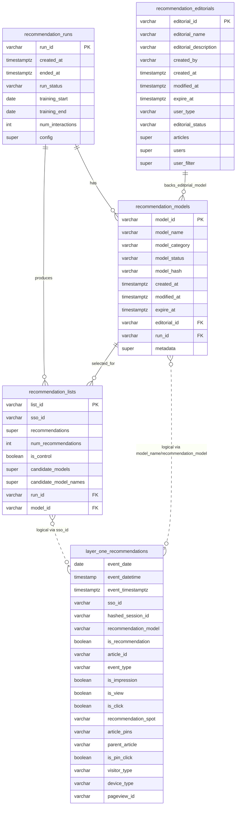

# Recommender

## Secrets

To setup secrets, create a copy of [`.env.template`](.env.template) as `.env` from recommender root.

```sh
cp -r .env.template .env
```

Fill out `.env` with secrets

```sh
AWS_ACCESS_KEY_ID=YOUR_AWS_ACCESS_KEY_ID
AWS_SECRET_ACCESS_KEY=YOUR_AWS_SECRET_ACCESS_KEY
AWS_S3_BUCKET=RECOMMENDATION_DATA_BUCKET_NAME
POL_CONNECTOR_DSN=PSYCOPG_DSN_TO_REDSHIFT
```

## Data

Recommendation data is stored in a Redshift database. All except `layer_one_re`The schema is as follows:


