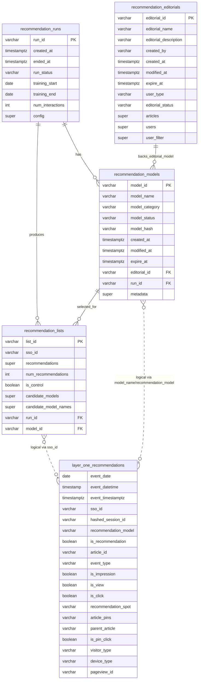

# Recommender

## Secrets

To setup secrets, create a copy of [`.env.template`](.env.template) as `.env` from recommender root.

```sh
cp -r .env.template .env
```

Fill out `.env` with secrets

```sh
AWS_ACCESS_KEY_ID=YOUR_AWS_ACCESS_KEY_ID
AWS_SECRET_ACCESS_KEY=YOUR_AWS_SECRET_ACCESS_KEY
AWS_S3_BUCKET=RECOMMENDATION_DATA_BUCKET_NAME
POL_CONNECTOR_DSN=PSYCOPG_DSN_TO_REDSHIFT
```

## Data

Recommendation data is stored in a Redshift database. All except `layer_one_re`The schema is as follows:



## Models

### `S3Recommender`

The `S3Recommender` extends `PoolRecommender`, pulling a pool of articles from an s3 bucket. By default, it uses the prod recommender bucket, and it can only use files from directory `s3-recommender/`.

The article pool file is expected to follow this format

```json
[art1, art2, art3, ..., artN]
```

A pool file can be uploaded with the [_aws cli_](https://aws.amazon.com/cli/) with

```sh
aws s3 cp /path/to/pool.json s3://your-bucket-name/s3-recommender/
```

The `s3-recommender/` directory can be created in a bucket with command

```sh
aws s3api put-object --bucket your-bucket-name --key s3-recommender/
```
